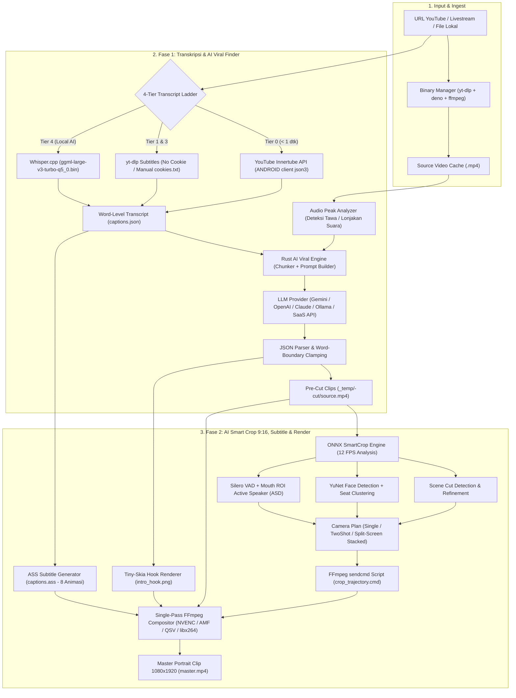

# OneKlip — Architecture & Implementation Blueprint (Rust + Tauri v2)

Dokumen ini adalah cetak biru teknis (*Technical Blueprint*) untuk membangun **OneKlip**, aplikasi desktop pembuat klip otomatis (*Auto-Clipper*) dari podcast dan livestream menggunakan **Rust (Tauri v2)**. Arsitektur ini mengadopsi seluruh keunggulan dari analisis [loka-clip.exe](file:///c:/Users/Administrator/AppData/Local/Loka%20Clip/loka-clip.exe) dan menyempurnakannya agar **100% mandiri (*standalone*)** sekaligus siap dikomersilkan (*SaaS-ready*).

> [!IMPORTANT]
> **Keunggulan Arsitektur OneKlip dibanding Aplikasi Contoh (`Loka Clip`):**
> 1. **100% Standalone AI Viral Engine di Rust:** Pada `Loka Clip`, fitur *Bring Your Own Key (BYOK)* masih bergantung pada server cloud mereka (`/highlights/byok/prepare` & `/complete`) untuk menyusun prompt dan mem-parsing output LLM. Di **OneKlip**, *Transcript Chunker*, *Prompt Builder*, dan *Structured JSON Validator* dibangun langsung di dalam **Rust**, sehingga bisa berjalan 100% tanpa ketergantungan server luar (mendukung Gemini, OpenAI, Claude, OpenRouter, DeepSeek, maupun Ollama lokal), namun tetap memiliki modul lisensi/kredit opsional jika Anda ingin menjualnya secara SaaS.
> 2. **Word-Boundary Clamping:** Titik potong `start_seconds` dan `end_seconds` dari AI diselaraskan otomatis dengan timestamp kata terdekat di transkrip + *padding* jeda napas (`0.15s`), sehingga tidak ada kata yang terpotong di awal/akhir video.
> 3. **Audio Energy & Laughter Hinting:** Sebelum transkrip dikirim ke LLM, Rust menganalisis *root-mean-square (RMS) audio peaks* untuk menandai bagian dengan lonjakan suara (tawa pecah, debat seru, reaksi kaget) langsung di dalam teks transkrip (`[AUDIO_PEAK: HIGH]`), meningkatkan akurasi deteksi momen viral secara signifikan.

---

## 1. Arsitektur End-to-End (Two-Phase Pipeline)



---

## 2. Struktur Direktori & Modul Rust (`OneKlip`)

Berikut adalah struktur proyek lengkap yang akan dibangun di `d:\Laravel\oneklip`:

```text
d:\Laravel\oneklip\
├── package.json                      # Frontend dependencies (React, Tailwind, Zustand, Lucide)
├── vite.config.ts
├── src/                              # Frontend UI (React + TypeScript)
│   ├── main.tsx
│   ├── App.tsx
│   ├── stores/                       # Zustand stores (session, editor, stylePacks, settings)
│   ├── components/
│   │   ├── dashboard/                # Input URL/File, Preset Selector, Progress Ladder
│   │   ├── clips/                    # Grid hasil klip, Virality Score Badge, Quick Preview
│   │   ├── editor/                   # Timeline Editor, Waveform, Filmstrip, Canvas Drag Overlay
│   │   └── settings/                 # AI BYOK Config, Cookies.txt Manager, Binary Updater, GPU Probe
│   └── style-packs/                  # 17 Preset bawaan (8 Hooks + 9 Subtitles dalam JSON)
│
└── src-tauri/                        # Backend Utama (Rust)
    ├── Cargo.toml
    ├── tauri.conf.json
    ├── migrations/
    │   └── V1__initial_schema.sql    # Skema SQLite (refinery)
    └── src/
        ├── main.rs
        ├── lib.rs                    # Inisialisasi AppState, DB, dan Tauri Invoke Handler
        ├── state.rs                  # AppState (Db, RenderOrchestrator, CancellationTokens)
        ├── error.rs                  # Unified Error Handling & Serialisasi ke Frontend
        ├── storage/
        │   └── mod.rs                # Wrapper rusqlite + refinery migrations + CRUD helpers
        ├── commands/                 # Tauri IPC Commands (dipanggil dari Frontend)
        │   ├── mod.rs
        │   ├── ai.rs                 # find_viral_highlights, byok_chat, test_ai_connection
        │   ├── download.rs           # probe_youtube_source, download_video, cut_clips
        │   ├── transcript.rs         # fetch_transcript_innertube, fetch_transcript_ytdlp, transcribe_local
        │   ├── render.rs             # render_clips, cancel_render, ensure_editor_clip
        │   ├── editor.rs             # editor_clip_filmstrip, editor_clip_peaks, import_editor_asset
        │   ├── sessions.rs           # list_sessions, get_session_clips, delete_session, save_captions
        │   └── system.rs             # detect_hardware, check_binaries, update_binary, cookies_manager
        └── services/                 # Core Business Logic & Engines
            ├── mod.rs
            ├── binaries/
            │   ├── manager.rs        # Auto-downloader yt-dlp, ffmpeg, ffprobe, deno, whisper, onnxruntime
            │   └── auto_update.rs    # Background checker versi terbaru dari GitHub Releases
            ├── innertube.rs          # YouTube Innertube API client (ANDROID / ANDROID_VR json3 parser)
            ├── ytdlp.rs              # Wrapper subprocess yt-dlp + progress parser + cookies handling
            ├── whisper.rs            # Ekstraksi WAV 16kHz + eksekusi whisper.cpp + DTW word timestamps
            ├── waveform.rs           # Ekstraksi audio peaks (untuk UI timeline & deteksi lonjakan tawa/emosi)
            ├── ai_viral/             # [BARU - 100% Lokal di Rust]
            │   ├── mod.rs
            │   ├── chunker.rs        # Pemecah transkrip panjang menjadi blok kontekstual + Audio Peak tags
            │   ├── prompts.rs        # Template System & User Prompt per ContentType (Podcast/Gaming/dll)
            │   ├── client.rs         # HTTP Client multi-provider (OpenAI/Gemini/Claude/Ollama/Custom)
            │   └── validator.rs      # Parser JSON toleran + Word-Boundary Clamping + Dedup segmen
            ├── smartcrop/            # AI Auto-Reframe 16:9 -> 9:16
            │   ├── mod.rs
            │   ├── onnx.rs           # Dynamic loader onnxruntime.dll + session pool
            │   ├── scene.rs          # Frame difference histogram untuk deteksi pergantian shot kamera
            │   ├── face.rs           # Inferensi YuNet (face_detection_yunet_2023mar.onnx)
            │   ├── track.rs          # IoU + Centroid face tracker & Seat Clustering (seatId)
            │   ├── vad.rs            # Inferensi Silero VAD (silero_vad.onnx)
            │   ├── asd.rs            # Active Speaker Detection (Mouth ROI jitter + korelasi VAD)
            │   ├── edit_plan.rs      # Banter Funnel (memutuskan mode Single, TwoShot, Wide, atau Stacked)
            │   ├── camera_plan.rs    # Smoothing pergerakan kamera (deadband + easing)
            │   └── trajectory.rs     # Serialisasi .trajectory.json & generator script FFmpeg sendcmd
            ├── subtitles.rs          # Engine konversi captions.json -> captions.ass (5 mode, 8 animasi)
            └── render/               # Video Composition & Encoding Engine
                ├── mod.rs
                ├── session.rs        # Orchestrator antrean render paralel (Semaphore)
                ├── worker.rs         # Pipeline pekerja per klip (Cut -> SmartCrop -> Hook -> Master)
                ├── progress.rs       # Parser stdout `-progress pipe:1` FFmpeg ke Event Tauri
                ├── subtitle_style.rs # Struct & validator gaya subtitle
                ├── hook_style.rs     # Struct & validator gaya hook
                ├── hook_overlay.rs   # Renderer PNG transparan menggunakan tiny-skia
                ├── hook_styles/
                │   ├── mod.rs
                │   ├── classic.rs    # Backdrop Gradient, Note, Marker, Bar
                │   ├── comic.rs      # Efek box komik miring + shadow + stroke
                │   ├── punchline.rs  # Efek garis aksen samping + tipografi tebal
                │   └── sticker.rs    # Teks berlapis inner/outer stroke + label Kicker & Tag
                ├── encoder/
                │   ├── mod.rs
                │   └── probe.rs      # Smoke-test GPU encoder (h264_nvenc, h264_amf, h264_qsv, libx264)
                └── stages/
                    ├── cut.rs        # Pemotongan akurat segmen sumber + jump-cut assembly
                    ├── reframe.rs    # Konstruksi filtergraph sendcmd crop + vstack split-screen
                    ├── caption.rs    # Penulisan captions.ass & filter subtitles
                    └── master.rs     # Eksekusi akhir FFmpeg (Video + Hook + ASS + Watermark + BGM)
```

---

## 3. Daftar Dependensi Rust (`src-tauri/Cargo.toml`)

```toml
[package]
name = "oneklip"
version = "0.1.0"
edition = "2021"

[lib]
name = "oneklip_lib"
crate-type = ["staticlib", "cdylib", "rlib"]

[build-dependencies]
tauri-build = { version = "2", features = [] }

[dependencies]
# Tauri Core & Plugins
tauri = { version = "2", features = ["protocol-asset"] }
tauri-plugin-shell = "2"
tauri-plugin-dialog = "2"
tauri-plugin-fs = "2"
tauri-plugin-notification = "2"
tauri-plugin-updater = "2"

# Async & Concurrency
tokio = { version = "1", features = ["full"] }
tokio-util = { version = "0.7", features = ["rt"] }
futures-util = "0.3"
rayon = "1.10"
parking_lot = "0.12"
crossbeam-channel = "0.5"

# Serialization & Data
serde = { version = "1", features = ["derive"] }
serde_json = "1"
uuid = { version = "1", features = ["v4", "serde"] }
chrono = { version = "0.4", features = ["serde"] }
regex = "1"
url = "2"

# Database (SQLite + Migrations)
rusqlite = { version = "0.32", features = ["bundled"] }
refinery = { version = "0.8", features = ["rusqlite"] }

# HTTP & Networking
reqwest = { version = "0.12", default-features = false, features = ["json", "stream", "rustls-tls", "cookies", "gzip", "brotli"] }

# AI Computer Vision (ONNX Runtime)
ort = { version = "2.0.0-rc.12", default-features = false, features = ["load-dynamic", "ndarray"] }
ndarray = "0.16"

# 2D Graphics & Font Rendering (Intro Hooks & Text Overlays)
tiny-skia = "0.11"
ttf-parser = "0.25"
ab_glyph_rasterizer = "0.1"
png = "0.17"

# System, Archive & Logging
sysinfo = "0.32"
zip = "2.4"
flate2 = "1.1"
tar = "0.4"
anyhow = "1.0"
thiserror = "2.0"
tracing = "0.1"
tracing-subscriber = { version = "0.3", features = ["env-filter", "fmt"] }
tracing-appender = "0.2"
```

---

## 4. Desain Skema Database SQLite (`V1__initial_schema.sql`)

Skema ini menyimpan seluruh sesi pemotongan, daftar klip, antrean *background jobs* (agar tahan *crash/restart*), serta *cache* pemeriksaan encoder GPU.

```sql
PRAGMA foreign_keys = ON;

-- 1. Tabel Sesi Proyek (1 Video Sumber = 1 Sesi)
CREATE TABLE IF NOT EXISTS sessions (
    id                 TEXT PRIMARY KEY,
    folder_path        TEXT NOT NULL,
    video_url          TEXT,
    video_id           TEXT,
    local_video_path   TEXT,
    video_title        TEXT,
    video_channel      TEXT,
    video_duration     REAL,
    video_language     TEXT DEFAULT 'id',
    content_type       TEXT NOT NULL DEFAULT 'podcast',
    status             TEXT NOT NULL DEFAULT 'created',
    highlights_count   INTEGER NOT NULL DEFAULT 0,
    clips_processed    INTEGER NOT NULL DEFAULT 0,
    total_size_bytes   INTEGER NOT NULL DEFAULT 0,
    last_error         TEXT,
    created_at         TEXT NOT NULL,
    updated_at         TEXT NOT NULL,
    completed_at       TEXT,
    CHECK (status IN (
        'created', 'downloading', 'transcribing', 'analyzing',
        'highlights_found', 'processing', 'completed', 'failed', 'canceled'
    ))
);

-- 2. Tabel Klip Hasil Deteksi AI & Render
CREATE TABLE IF NOT EXISTS clips (
    id                  TEXT PRIMARY KEY,
    session_id          TEXT NOT NULL,
    position            INTEGER NOT NULL,
    start_seconds       REAL NOT NULL,
    end_seconds         REAL NOT NULL,
    duration_seconds    REAL NOT NULL,
    title               TEXT NOT NULL,
    hook_text           TEXT,
    hook_kicker         TEXT,
    hook_tag            TEXT,
    description         TEXT,
    category            TEXT DEFAULT 'general',
    virality_score      INTEGER NOT NULL DEFAULT 7,
    video_layout        TEXT NOT NULL DEFAULT 'smart_speaker',
    preview_path        TEXT,
    file_path           TEXT NOT NULL,
    file_size_bytes     INTEGER,
    resolution          TEXT DEFAULT '1080x1920',
    has_hook            INTEGER NOT NULL DEFAULT 1,
    has_captions        INTEGER NOT NULL DEFAULT 1,
    has_watermark       INTEGER NOT NULL DEFAULT 0,
    editor_state_json   TEXT, -- Menyimpan kustomisasi timeline/jumps/style per klip
    exported_to         TEXT,
    created_at          TEXT NOT NULL,
    FOREIGN KEY (session_id) REFERENCES sessions(id) ON DELETE CASCADE
);

CREATE INDEX IF NOT EXISTS idx_clips_session ON clips(session_id);

-- 3. Tabel Antrean Job Lokal (Crash Recovery & Progress Tracking)
CREATE TABLE IF NOT EXISTS local_jobs (
    id              TEXT PRIMARY KEY,
    session_id      TEXT NOT NULL,
    clip_id         TEXT,
    type            TEXT NOT NULL,
    status          TEXT NOT NULL DEFAULT 'pending',
    progress        INTEGER NOT NULL DEFAULT 0,
    sub_progress    REAL DEFAULT 0.0,
    current_step    TEXT,
    input_path      TEXT,
    output_path     TEXT,
    parameters      TEXT,
    error_message   TEXT,
    error_code      TEXT,
    retry_count     INTEGER NOT NULL DEFAULT 0,
    max_retries     INTEGER NOT NULL DEFAULT 2,
    created_at      TEXT NOT NULL,
    updated_at      TEXT NOT NULL,
    started_at      TEXT,
    completed_at    TEXT,
    FOREIGN KEY (session_id) REFERENCES sessions(id) ON DELETE CASCADE,
    CHECK (type IN (
        'DOWNLOAD_VIDEO', 'EXTRACT_AUDIO', 'TRANSCRIBE_LOCAL',
        'HIGHLIGHTS_AI', 'CUT_VIDEO', 'SMART_CROP_ANALYZE',
        'RENDER_MASTER', 'EXPORT'
    )),
    CHECK (status IN (
        'pending', 'running', 'completed', 'failed',
        'canceled', 'paused', 'interrupted'
    ))
);

CREATE INDEX IF NOT EXISTS idx_local_jobs_session ON local_jobs(session_id);
CREATE INDEX IF NOT EXISTS idx_local_jobs_status  ON local_jobs(status);

-- 4. Key-Value Cache (Untuk menyimpan hasil probe GPU encoder, versi binary, dll)
CREATE TABLE IF NOT EXISTS cache_kv (
    key         TEXT PRIMARY KEY,
    value       TEXT NOT NULL,
    expires_at  TEXT,
    created_at  TEXT NOT NULL
);
```

---

## 5. Desain AI Viral Moment Engine & Prompt System (`services/ai_viral/`)

Agar aplikasi Anda menghasilkan potongan klip yang benar-benar menarik dan tidak memotong pembicaraan secara canggung, modul `ai_viral` di Rust bekerja dalam 3 tahap:

### 5.1. Tahap Pre-Processing: Transcript Block Formatting + Audio Peak Tagging
Transkrip mentah (`captions.json`) sering kali terdiri dari ribuan baris pendek (2–3 detik). Jika dikirim mentah ke LLM, token menjadi boros dan akurasi timestamp menurun.
Rust akan menggabungkan segmen menjadi baris berformat padat dengan **Timestamp Detik Presisi** dan menyisipkan penanda lonjakan energi suara (`[PEAK_AUDIO]` jika RMS audio pada detik tersebut > 1.8x rata-rata, menandakan tawa pecah atau penekanan emosi):

```text
[1258.40 - 1264.20] Jadi waktu di pesawat kemarin, sebelah gua nanya lu kerja apa.
[1264.20 - 1271.50] [PEAK_AUDIO] Gua ngibul aja bilang gua YouTuber politik biar kelihatan keren!
[1271.50 - 1278.10] [PEAK_AUDIO] Terus bapaknya langsung serius nanya gimana nasib koalisi, mati kutu gua!
```

### 5.2. System Prompt & User Prompt Pendeteksi Momen Viral
Berikut adalah rancangan prompt di `src/services/ai_viral/prompts.rs` yang dirancang khusus untuk pasar konten pendek (TikTok / Reels / YouTube Shorts):

```markdown
### SYSTEM PROMPT
Anda adalah Senior Viral Video Editor & Content Strategist kelas dunia untuk TikTok, Instagram Reels, dan YouTube Shorts.
Tugas Anda adalah menganalisis transkrip video berdurasi panjang (Podcast / Livestream / Talkshow / Edukasi) dan mengekstrak {{clip_count}} segmen klip mandiri yang memiliki potensi viral tertinggi.

ATURAN KRITIS PEMILIHAN KLIP:
1. STRUKTUR NARASI LENGKAP (Hook -> Setup -> Payoff/Punchline):
   - Setiap klip WAJIB dimulai dengan kalimat pembuka yang langsung memancing rasa penasaran (Strong Hook) atau konteks masalah yang jelas.
   - Jangan pernah memulai klip di tengah kalimat yang menggantung atau mengakhiri klip sebelum punchline/kesimpulan selesai diucapkan.
2. DURASI IDEAL ({{length_preset}}):
   - Preset "short": 30 - 55 detik (fokus pada 1 punchline cepat / momen lucu).
   - Preset "balanced": 50 - 90 detik (cerita utuh, perdebatan seru, atau insight mendalam).
   - Preset "story": 80 - 150 detik (storytelling lengkap dari awal hingga akhir).
3. SINYAL VIRALITAS:
   - Prioritaskan segmen yang memiliki: pengakuan mengejutkan (confession), opini kontroversial/berani, cerita lucu/awkward (perhatikan tag [PEAK_AUDIO]), perdebatan panas, atau tips praktis yang jarang diketahui.
   - Hindari bagian basa-basi pembuka ("Halo guys, kembali lagi..."), pembacaan sponsor/iklan, atau obrolan teknis yang bertele-tele.
4. ATURAN BAHASA & HOOK:
   - Gunakan bahasa yang sama dengan transkrip ({{language}}). Untuk Bahasa Indonesia, gunakan gaya bahasa kasual/sosmed yang punchy dan memancing komentar.
   - `hook_text`: Maksimal 6 kata (35 karakter), HURUF KAPITAL, merangkum konflik/kelucuan utama klip untuk dipasang sebagai banner di 3 detik pertama.
   - `hook_labels.kicker`: Label kecil di atas hook (maks 2-3 kata, misal: "CERITA KOCAK", "FAKTA PAHIT", "DEBAT PANAS").
   - `hook_labels.tag`: Label kecil di bawah hook (maks 2 kata, misal: "PLOT TWIST!", "WAJIB TAHU!", "AUTO PANIK!").

FORMAT OUTPUT:
Kembalikan HANYA JSON valid sesuai skema berikut tanpa markdown tambahan:
{
  "highlights": [
    {
      "start_seconds": 1260.4,
      "end_seconds": 1344.48,
      "title": "Biar Keren, Niki Ngibul Jadi YouTuber Politik ke Penumpang Pesawat",
      "hook_text": "NGAKU YOUTUBER POLITIK!",
      "hook_labels": {
        "kicker": "NGIBUL DI PESAWAT",
        "tag": "MALU BANGET!"
      },
      "description": "Cerita relatable dan lucu saat terpaksa berbohong soal pekerjaan di pesawat dan berujung senjata makan tuan.",
      "category": "comedy",
      "virality_score": 9
    }
  ]
}
```

### 5.3. Tahap Post-Processing: Word-Boundary Clamping (`validator.rs`)
Ketika LLM mengembalikan `start_seconds: 1260.4` dan `end_seconds: 1344.48`, kode Rust akan:
1. Mencari kata pertama di `captions.json` yang berada di sekitar `1260.4`, lalu mengambil `word.start - 0.12` detik (memberi ruang napas awal).
2. Mencari kata terakhir di akhir kalimat sekitar `1344.48`, lalu mengambil `word.end + 0.25` detik (agar suara kata terakhir tidak terpenggal).
3. Memastikan tidak ada dua klip yang tumpang tindih (*overlap* > 20%).
4. Mengurutkan hasil berdasarkan `virality_score` tertinggi.

---

## 6. Spesifikasi AI Smart Crop 9:16 & Single-Pass FFmpeg Filtergraph

### 6.1. Pipeline Analisis `smartcrop` (ONNX Runtime)
Untuk setiap klip yang akan di-render dengan layout `smart_speaker`:
1. **Ekstraksi Frame & Audio:** FFmpeg mengekstrak stream video resolusi rendah (misal lebar 640px pada 12 FPS) ke *stdout pipe* dan audio 16kHz untuk VAD.
2. **Deteksi Wajah (`YuNet`) & Tracking:** Mendapatkan *bounding box* wajah `[x, y, w, h]` dan 5 titik *facial landmarks* (mata, hidung, ujung mulut).
3. **Active Speaker Detection (`asd.rs`):** Menghitung varians bukaan mulut (*mouth aspect ratio / ROI jitter*) selama jendela waktu aktif suara dari `silero_vad.onnx`.
4. **Keputusan Framing (`edit_plan.rs`):**
   * Jika 1 orang dominan berbicara → `mode: "single"` (fokus crop 9:16 ke `cx` pembicara tersebut).
   * Jika 2 orang berbicara bergantian sangat cepat (*banter* ≥ 4 pergantian dalam satu *window*) dan jarak horizontal antar wajah > lebar crop 9:16 (`607.5px` pada sumber 1080p) → aktifkan **Split-Screen Atas-Bawah (`stacked`)**.
   * Jika tidak ada wajah terdeteksi → `mode: "wide"` (tengah).

### 6.2. Arsitektur FFmpeg Filtergraph (`stages/reframe.rs` & `stages/master.rs`)
Seluruh elemen visual digabungkan dalam **satu perintah FFmpeg** agar tidak terjadi penurunan kualitas akibat *re-encoding* berulang:

* **Reframing & Split-Screen:**
  ```text
  [0:v]split=2[vmain][vstk0];
  [vmain]sendcmd=f='crop_trajectory.cmd',crop@c=ih*9/16:ih:(iw-ih*9/16)/2:0,scale=1080:1920:flags=lanczos,fps=30[single];
  [vstk0]split=2[vt0][vb0];
  [vt0]crop=w_top:h_top:x_top:y_top,scale=1080:960:flags=lanczos,fps=30[ptop0];
  [vb0]crop=w_bot:h_bot:x_bot:y_bot,scale=1080:960:flags=lanczos,fps=30[pbot0];
  [ptop0][pbot0]vstack=inputs=2[stacked0];
  [single][stacked0]overlay=0:0:enable='between(t,34.08,35.25)':eof_action=pass[base]
  ```
* **Intro Hook PNG Overlay + Subtitle ASS Burn-in + Watermark + BGM Audio Mix:**
  ```text
  [base][1:v]overlay=0:0:enable='between(t,0.0,3.5)':eof_action=pass[with_hook];
  [with_hook]subtitles='captions.ass':fontsdir='resources/fonts'[subbed];
  [subbed][2:v]overlay=W-w-40:40[final_v];
  [0:a]volume=1.0[clipa];
  [3:a]volume=0.18[bgm];
  [clipa][bgm]amix=inputs=2:duration=first:normalize=0[final_a]
  ```

---

## 7. Rencana Eksekusi Bertahap (Langkah 2 — Implementasi Kode)

Setelah cetak biru ini disetujui, kita akan mengeksekusi pembangunan kode proyek **OneKlip** di `d:\Laravel\oneklip` secara berurutan dalam **5 Tahap Modular**:

1. **Tahap 2A — Project Scaffolding, Database & Binary Manager:**
   * Inisialisasi proyek Tauri v2 + React + TypeScript + Tailwind di `d:\Laravel\oneklip`.
   * Implementasi `storage` (SQLite + migrasi `V1__initial_schema.sql`), `state.rs`, dan `binaries/manager.rs` (pendeteksi & pengunduh otomatis `ffmpeg`, `ffprobe`, `yt-dlp`, `deno`, `whisper`, `onnxruntime`, serta model ONNX/GGML).
2. **Tahap 2B — Fase 1: Ingest, 4-Tier Transcript Ladder & Standalone AI Viral Engine:**
   * Implementasi `innertube.rs` (Tier 0), `ytdlp.rs` (Tier 1 & 3 + `cookies.txt`), dan `whisper.rs` (Tier 4).
   * Implementasi `services/ai_viral/*` (Chunker, Audio Peak Tagger, Multi-Provider LLM Client untuk Gemini/OpenAI/Ollama, Prompt System, dan Word-Boundary Clamping) + `cut_clips`.
3. **Tahap 2C — Fase 2: Engine Subtitle Animasi (`.ass`) & Hook Renderer (`tiny-skia`):**
   * Implementasi `subtitles.rs` (5 *Reveal Modes* & 8 Animasi `libass` lengkap dengan 9 preset JSON).
   * Implementasi `hook_overlay.rs` (`classic`, `comic`, `punchline`, `sticker` lengkap dengan 8 preset JSON).
4. **Tahap 2D — Fase 2: AI Smart Crop 9:16 (ONNX) & Hardware GPU Render Worker:**
   * Implementasi `services/smartcrop/*` (YuNet Face Detection, Silero VAD, Active Speaker Detection, Split-Screen Banter Funnel, `sendcmd` generator).
   * Implementasi `services/render/*` (GPU Encoder Probe `nvenc`/`amf`/`qsv`/`libx264` & Single-Pass FFmpeg Master Compositor).
5. **Tahap 2E — Frontend UI & Interactive Timeline Editor:**
   * Pembuatan antarmuka Dashboard, Kartu Hasil Klip dengan Skor Viralitas, Pengaturan AI/Cookies, dan Timeline Editor interaktif (Live Preview, Edit Transkrip, Jump-Cut, BGM, Export).
